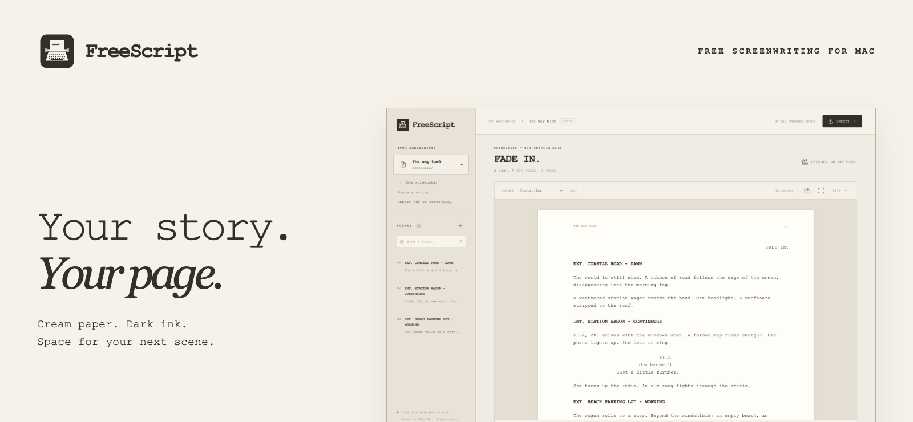
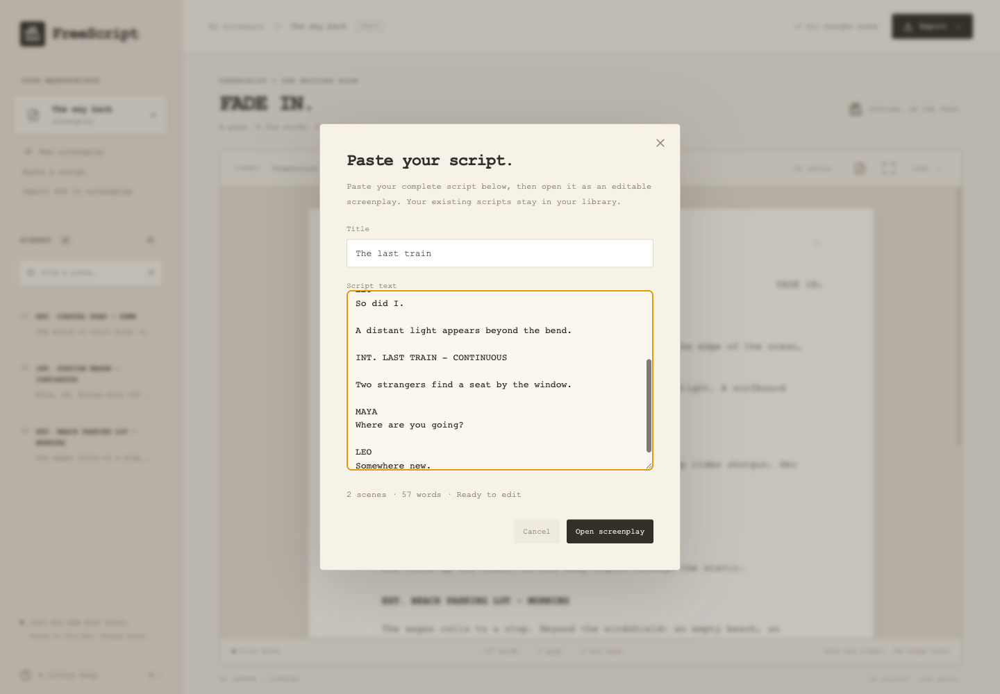
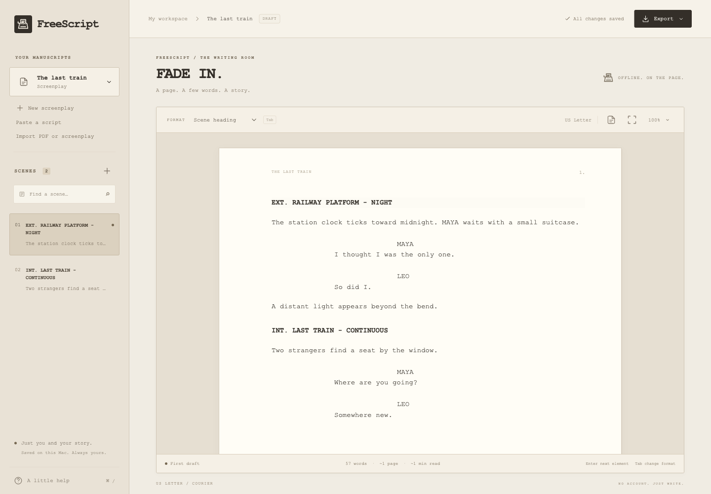
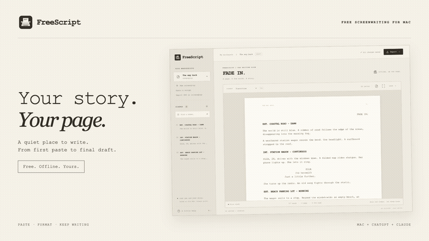
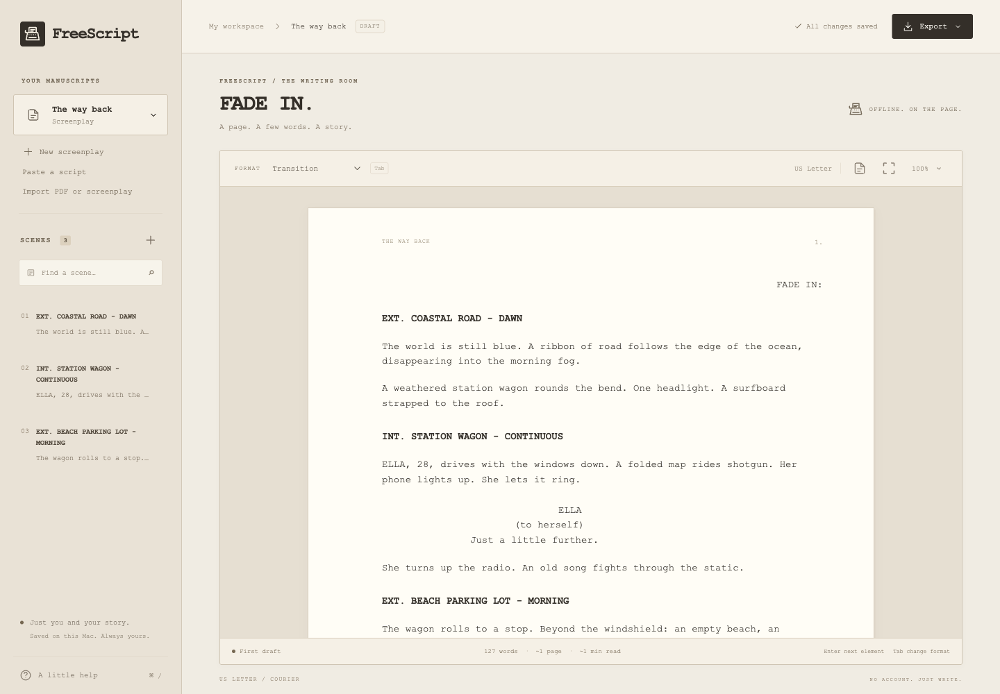
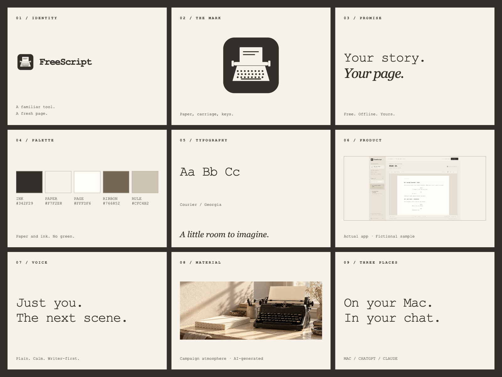

# FreeScript



**Your story. Your page.** A free, offline screenplay editor for Mac. Paste a draft or import a text-based PDF, then keep writing in a cream-paper, dark-ink workspace.

**[Download for Mac (.dmg)](https://github.com/taylordrew4u2/FreeScript/releases/download/v1.0.3/FreeScript-1.0.3-Mac-universal.dmg)** · **[Watch the demos](https://customtechbuilt4u.com/work/freescript/#project-promotion)** · **[ChatGPT & Claude setup](integrations/README.md)** · **[Brand & press kit](https://github.com/taylordrew4u2/FreeScript/releases/tag/brand-kit-v1)**

Free desktop software. No account or subscription required for the Mac editor. Your drafts autosave on your Mac.

## From an existing script to the next scene

1. **Bring your draft.** Use **Paste a script**, or **Import PDF or screenplay** for a PDF with selectable text, Fountain, plain text, or a FreeScript JSON backup.
2. **Find the format.** FreeScript recognizes common scene headings, action, character cues, dialogue, parentheticals, and transitions. Review the result and adjust an element with the format menu or Tab.
3. **Keep writing.** Navigate scenes, search, enter focus mode, undo edits, and export Fountain, a JSON backup, or a US Letter screenplay PDF with a title page.

| Paste your script | Keep writing |
| --- | --- |
|  |  |

All product captures use fictional sample writing. No private manuscript is shown.

## See it in motion

[](https://customtechbuilt4u.com/work/freescript/#project-promotion)

**[Watch the 31-second workflow demo and 15-second vertical promo](https://customtechbuilt4u.com/work/freescript/#project-promotion)**. Both are silent, captioned motion presentations assembled from genuine app captures, with fictional writing. They are edited product demonstrations rather than uncut screen recordings.

Download the [landscape MP4](https://github.com/taylordrew4u2/FreeScript/releases/download/brand-kit-v1/FreeScript-workflow-demo.mp4), [vertical MP4](https://github.com/taylordrew4u2/FreeScript/releases/download/brand-kit-v1/FreeScript-social-promo.mp4), or read the [workflow captions](branding/video/workflow-demo.vtt).

## The writing room



- Native Mac menus, keyboard shortcuts, spellcheck, focus mode, and zoom.
- Multiple screenplays with scene navigation, search, local autosave, and undo/redo.
- Automatic formatting for pasted drafts and editable text-based PDF imports.
- Fountain import/export, complete JSON backups, and formatted PDF export.
- A universal Mac installer for Apple Silicon and Intel.

## ChatGPT and Claude companion

The separate [hosted FreeScript companion](https://freescript-ai-companion.onrender.com) formats, revises, analyzes, and exports screenplay text in ChatGPT and Claude. The assistant supplies creative text; the tools structure and transform it. No separate AI API key is required.

Use `https://freescript-ai-companion.onrender.com/mcp` as a custom MCP plugin/connector, with **No authentication**. An [optional local Claude Desktop extension](https://github.com/taylordrew4u2/FreeScript/releases/download/plugins-v0.1.0/FreeScript-Claude-0.1.0.mcpb) can work with Fountain files in a separately chosen folder.

The hosted companion is online and stateless. Chat provider account requirements and the free host's limits apply; the service can take longer to respond after inactivity. Your Mac autosave library and the chat companion are separate: transfer drafts through import/export. **There is no automatic sync.** See [installation and privacy details](integrations/README.md).

## Install on Mac

Requires **macOS 13 Ventura or later**. The universal installer supports Apple Silicon and Intel; runtime testing was on Apple Silicon, with physical Intel testing pending.

1. Open the [FreeScript DMG](https://github.com/taylordrew4u2/FreeScript/releases/download/v1.0.3/FreeScript-1.0.3-Mac-universal.dmg).
2. Drag **FreeScript** into **Applications**, then open it.
3. This release is **Developer ID signed, not notarized**. If macOS blocks it, review **System Settings → Privacy & Security** after attempting to open it, and only allow a copy you trust from this repository.

Scanned PDFs need OCR first. Imports are limited to 10 MB, and automatically inferred formatting should be reviewed. Advanced Fountain markup is not fully supported. The editor uses a continuous writing surface; page counts are estimates, while PDF export determines final pagination.

The desktop editor works offline and stores drafts in its local application data. Removing that data removes the drafts, so export independent backups regularly. The desktop app has no telemetry or cloud sync. The optional hosted chat companion has its own [privacy details](integrations/README.md#privacy-and-limits).

## Identity & promotional material



The brand kit includes SVG/PNG logo variants, the original app icon, design tokens, brand guidelines, a 1920 × 1080 banner, square and vertical social graphics, editorial campaign artwork, genuine screenshots, launch copy, and both captioned videos. The campaign photograph is AI-generated promotional imagery, not an app capture or a physical FreeScript product.

**[Download the complete brand kit](https://github.com/taylordrew4u2/FreeScript/releases/download/brand-kit-v1/FreeScript-brand-and-promo-kit.zip)** · [Brand guidelines](branding/BRAND-GUIDELINES.md) · [Launch copy](branding/PROMOTIONAL-COPY.md) · [Asset provenance](branding/ASSET-MANIFEST.md)

See the full project and media gallery in the [4u Digital portfolio](https://customtechbuilt4u.com/work/freescript/).

## Keyboard shortcuts

| Action | Shortcut |
| --- | --- |
| New screenplay | ⌘ N |
| Import PDF / screenplay | ⌘ O |
| Export / save backup | ⌘ S |
| Export PDF | ⌘ P |
| Undo / redo | ⌘ Z / ⌘ Shift Z |
| Focus mode | ⌘ Shift F |
| Help | ⌘ / |
| Next element | Enter |
| Change element type | Tab / Shift Tab |
| New line in the same element | Shift Enter |

Select All in the editor selects the current element. Use Fountain export to copy the complete screenplay to another app.

## Develop

Use Node.js 22.12+ or a newer supported LTS version and npm.

```sh
npm ci
npm start             # build and launch the Mac desktop app
npm run dev           # browser development server
npm test              # screenplay and import/export tests
npm run test:desktop  # automated tests in the real Electron app
```

`test:desktop` uses temporary app storage and leaves your writing library untouched. Desktop testing and DMG creation require macOS.

## Build the DMG

```sh
npm ci
npm run dist:mac
```

The universal installer is generated in `release/`. App icons are checked in; regenerate them on macOS with `sh scripts/make-icon.sh`.

The packaging script builds in a temporary folder before copying the installer into `release/`. This avoids Finder/File Provider metadata breaking macOS code signatures when the repository is inside Documents or iCloud Drive.

The default configuration applies only an ad hoc signature for local app integrity. It has no Apple Developer ID signature or notarization, so Gatekeeper treats it as an unidentified developer. A future notarized release needs an Apple **Developer ID Application** identity and Apple notarization credentials; an Apple Development certificate is insufficient for distribution through Gatekeeper. Never commit signing credentials.

To build with a Developer ID identity installed alongside its private key in Keychain:

```sh
FREESCRIPT_SIGNING_IDENTITY='Developer ID Application: Your Name (TEAMID)' npm run dist:mac
```

To also notarize and staple the app before packaging, save notarization credentials with `xcrun notarytool store-credentials`, then pass their profile name:

```sh
FREESCRIPT_SIGNING_IDENTITY='Developer ID Application: Your Name (TEAMID)' \
APPLE_KEYCHAIN_PROFILE=FreeScript npm run dist:mac
```

The profile stays in your Keychain. Do not put app-specific passwords, private keys, or `.p12` files in this repository.

## License

[MIT](LICENSE). Electron and other dependencies retain their own licenses.
